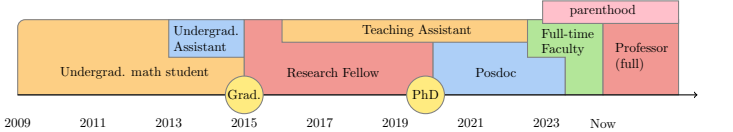

Can biological systems be understood from incomplete or noisy data? That question drives my research.

I am a Professor and Researcher in the href="https://www.matematica.uns.edu.ar/default.php">Department of Mathematics</a> at the <a href="https://uns.edu.ar">Universidad Nacional del Sur</a>. As an applied mathematician, I use dynamical systems, stochastic modeling, and computational methods to study neural and biological systems. My work focuses on inverse problems: reconstructing the dynamics of a system from observations that are partial, noisy, or both, and determining what information about the system those observations actually preserve.

--### Students--

I supervise undergraduate and graduate students in computational neuroscience and applied dynamical systems. If you are looking for a thesis topic or a first research project, I have three ready-to-start projects on neuronal network dynamics, synaptic models, and ionic imbalances in rhythm generation. <a href="https://uliseschialva.github.io/students/">See the projects and how to apply →</a>

<!--### Visual CV-->

<!---->

### Contact

[uchialva@gmail.com](mailto:uchialva@gmail.com)
